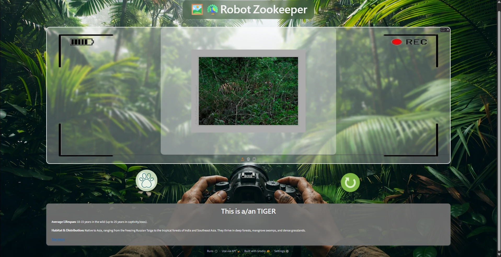
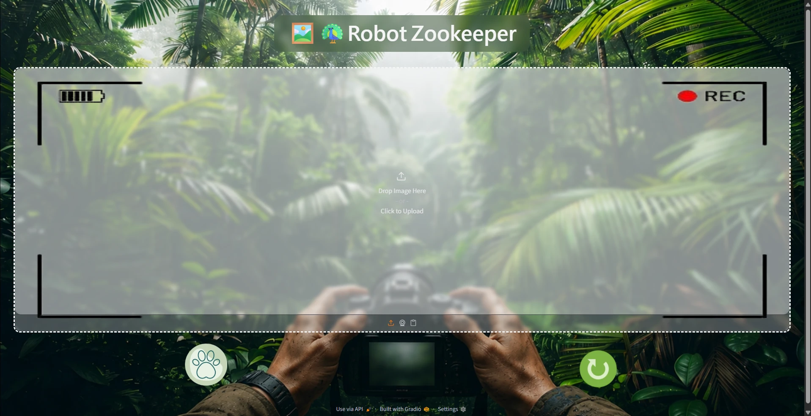
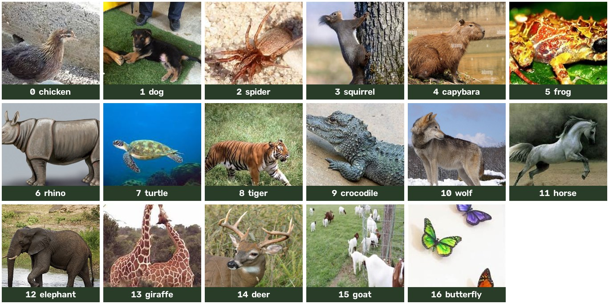

# 🦚 Robot Zookeeper – Animal Identifier

**[English](#english)** | **[Tiếng Việt](#tiếng-việt)**

---

## English

### About the app
Robot Zookeeper is a web app that recognizes animals in photos. Upload a
picture and the app tells you which animal it is, together with its average
lifespan, habitat & distribution, and a Wikipedia link to learn more.

The model is an EfficientNetB0 network (pre-trained on ImageNet) fine-tuned
on about 22,000 images of 17 animal species. The interface is built with
Gradio and runs on Google Colab.

### How to use

1. Add an image in one of three ways (icons under the camera frame):
   upload a file / take a photo with the webcam / paste from the clipboard.
2. Press the **paw** button to identify the animal.
3. Press the **green circular-arrow** button to clear and try another image.

### Which images to use
- **Formats:** JPG, PNG, WEBP (any size; the app resizes to 256×256 itself).
- The image should contain **ONE** animal from the 17 species listed below.
- **Best results:** a clear photo where the animal is large and easy to see.
  The model can still find animals that are partly hidden (e.g. a tiger in
  the bushes, as in the screenshot above), but blurry, very dark or very
  small animals are harder.
- If the model is less than **65%** sure, the app says it is not confident
  instead of guessing. This often (but not always) happens with animals
  the app does not know (cats, birds, fish, ...) or photos without any
  animal – it may still pick the most similar species from the list.

### Supported animals

| Class | Animal | Class | Animal | Class | Animal |
|---|---|---|---|---|---|
| 0 | chicken | 6 | rhino | 12 | elephant |
| 1 | dog | 7 | turtle | 13 | giraffe |
| 2 | spider | 8 | tiger | 14 | deer |
| 3 | squirrel | 9 | crocodile | 15 | goat |
| 4 | capybara | 10 | wolf | 16 | butterfly |
| 5 | frog | 11 | horse | | |

---

## Tiếng Việt

### Giới thiệu app
Robot Zookeeper là web app nhận diện động vật qua ảnh. Bạn tải ảnh lên, app
sẽ cho biết đó là con gì, kèm tuổi thọ trung bình, môi trường sống & phân bố,
và link Wikipedia để tìm hiểu thêm.

Model dùng mạng EfficientNetB0 (đã học sẵn trên ImageNet) được fine-tune trên
khoảng 22.000 ảnh của 17 loài động vật. Giao diện làm bằng Gradio, chạy trên
Google Colab.

### Cách sử dụng

1. Đưa ảnh vào bằng 1 trong 3 cách (các biểu tượng dưới khung máy quay):
   tải file lên / chụp bằng webcam / dán từ clipboard.
2. Bấm nút **hình bàn chân** để nhận diện.
3. Bấm nút **mũi tên tròn màu xanh** để xóa và thử ảnh khác.

### Nên dùng ảnh như thế nào
- **Định dạng:** JPG, PNG, WEBP (kích thước bất kỳ, app tự resize về 256×256).
- Ảnh chỉ nên có **MỘT** con vật thuộc 17 loài trong danh sách bên dưới.
- **Cho kết quả tốt nhất:** ảnh rõ nét, con vật chiếm phần lớn khung hình.
  Model vẫn nhận ra được con vật bị che một phần (ví dụ hổ nấp trong bụi
  cây như ảnh chụp ở đầu trang), nhưng ảnh mờ, quá tối hoặc con vật quá nhỏ
  sẽ khó nhận diện hơn.
- Nếu model chắc chắn dưới **65%**, app sẽ báo không chắc thay vì đoán bừa.
  Điều này thường (nhưng không phải lúc nào cũng) xảy ra với con vật app
  không biết (mèo, chim, cá, ...) hoặc ảnh không có con vật nào – app vẫn có
  thể chọn loài giống nhất trong danh sách.

### Các loài app nhận diện được

| Lớp | Con vật | Lớp | Con vật | Lớp | Con vật |
|---|---|---|---|---|---|
| 0 | gà | 6 | tê giác | 12 | voi |
| 1 | chó | 7 | rùa | 13 | hươu cao cổ |
| 2 | nhện | 8 | hổ | 14 | hươu nai |
| 3 | sóc | 9 | cá sấu | 15 | dê |
| 4 | capypara | 10 | sói | 16 | bướm |
| 5 | ếch | 11 | ngựa | | |
